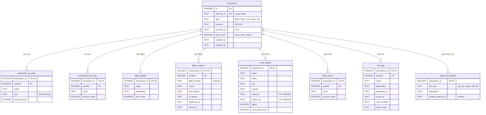
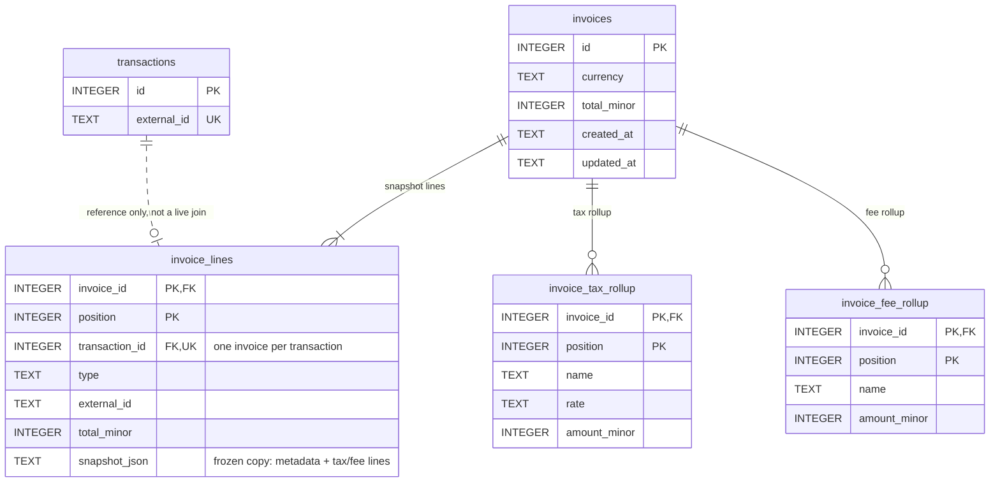

# Architecture

## Seams

```
HTTP          transaction.controller / invoice.controller   parse, validate shape, map to and from JSON
Use cases     transaction.service / invoice.service         @Transactional boundary, business rules
Identity      transaction.identity                          one row per external_id (DB-enforced)
Persistence   transaction.persistence (+ metadata/*)        SQL for header, tax/fee lines, per-type tables
              invoice.persistence                           SQL for invoice header, snapshot lines, rollups
Snapshot      invoice.snapshot                              pure: transactions → invoice draft + rollups
Models        transaction.dto / invoice.dto                 records shared by the layers above
Shared        common.*                                      errors, public ids, money, paging, time
```

Repositories are `@Transactional(propagation = MANDATORY)`: they only run inside a service's transaction, so every
use case is exactly one DB transaction.

Dependency direction: invoice → transaction. Transaction asks "is this invoiced?" through the
`InvoiceReferenceChecker` interface it owns, which `InvoiceRepository` implements.

## `external_id` uniqueness & concurrent POSTs

Duplicate identity is a database rule: `ux_transactions_external_id` is a UNIQUE index. A create is one DB
transaction:

1. `TransactionIdentityService.claim` runs `INSERT … ON CONFLICT (external_id) DO NOTHING RETURNING id`.
   - A returned id means this request won.
   - No row means the `external_id` exists. The service looks up that row's id and answers
     `409 duplicate_external_id` with `existing_id`.
2. The tax lines, fee lines and type metadata are inserted in the same transaction. If any of that fails, the
   header rolls back too, so a transaction is stored whole or not at all.

**Concurrent POSTs.** No read-then-insert window exists: the unique index picks exactly one winner. With
`transaction_mode=IMMEDIATE`, the second POST waits for the first to commit, then hits the conflict. Without it,
for example on Postgres, `ON CONFLICT` still lets only one insert through.

**Decisions:**

- A duplicate gets `409` with `existing_id`, not `200`. The client learns that it is a replay and where the stored
  row is.
- The bodies are not compared. Any reuse of an `external_id` is a `409`, and the stored row is never overwritten.
- The duplicate check runs before body rules such as "a flight needs at least one coupon". The fixture's
  `duplicate_flight` (empty `coupons`) therefore gets `409`, not `400`.

**Tests:**

- `ConcurrentDuplicateCreateTest`: 16 overlapping HTTP POSTs leave one row.
- `TransactionIdentityServiceTest.overlappingClaimsProduceExactlyOneWinner`: the same race one layer down.

## Invoice snapshot

An invoice is built from **stored** transactions and then copied, so it never changes when a transaction changes.

- **Write.** `InvoiceSnapshotBuilder` is a pure function from transactions to an `InvoiceDraft`. It checks the
  currency, copies each transaction into a `TransactionSnapshot`, sums the total exactly, and builds the rollups.
  Each line is stored as `snapshot_json` (type, total, tax/fee lines, metadata), plus a few plain columns. The
  rollups are computed once and stored.
- **Read.** `InvoiceRepository.hydrate` reads only the four invoice tables. Nothing joins to `transactions`, so the
  invoice is not a live view. The test `t04_invoiceIsASnapshot` changes the stored flight in SQL; the invoice
  still shows `220.00`.
- **Rollups.**
  - Taxes group by `(name, rate)`, with rates compared numerically (`0.07` = `0.070`).
  - Fees group by `name`.
  - Both lists keep first-seen order, which matches `expected-invoice.json`.
- **Request rules**, in this order. All are checked before the first write.
  - Same id twice → `409 duplicate_invoice_line`.
  - Unknown id → `404`.
  - Already on another invoice → `409 transaction_already_invoiced`, naming that invoice.
  - Mixed currency → `409 mixed_currency`.
- **One invoice per transaction.** The service checks this to give a precise error. `ux_invoice_lines_transaction_id`
  (UNIQUE) guarantees it even if the check were bypassed. If the index ever fired, the request would fail as a `500`
  and roll back; Spring does not classify SQLite constraint errors. Under `IMMEDIATE` the service check always runs
  first, so this path is not reachable.
- **Frozen transactions.** A transaction on an invoice answers `409 transaction_invoiced` to PATCH and DELETE. As a
  backstop, `invoice_lines.transaction_id` references `transactions(id)` without cascade, so the database also
  refuses the delete.
- **PATCH invoice.** It rebuilds from the current stored transactions under the same rules, but does not count
  "already on this invoice" as a conflict. In one transaction it updates the header, deletes the lines and rollups,
  and inserts the new ones. A failed PATCH leaves the invoice byte-for-byte unchanged.
- **DELETE invoice.** Lines and rollups cascade. The transactions stay, and they are editable again.

**Why JSON for the snapshot but tables for live data:** a snapshot is written once and read whole, and nothing
queries inside it. It must also keep its old shape if the transaction model later changes. The columns that do get
queried are real columns: `transaction_id`, `type`, `external_id`, `total_minor`, and the rollup tables.

## Tables & models

### Transactions and type-specific details



**Taxes vs fees.** They are separate tables and separate types: `TaxLine(name, rate?, amount)` and
`FeeLine(name, amount)`.

- A tax may carry a rate (VAT `0.07`) or none (a flat airport tax). A fee never has a rate.
- They roll up differently: taxes by name and rate, fees by name.
- The API keeps them as separate lists.

Separate tables keep "which list" in the schema instead of in a `kind` column. `position` preserves list order on
GET.

**Type-specific data.** The header holds what every type has; each type gets its own tables:

| Type | Tables | Holds |
|---|---|---|
| `flight` | `flight_details` + `flight_coupons` | Origin/destination and fare; one row per coupon with flight number (indexed), carrier, from/to, departure/arrival |
| `hotel` | `hotel_details` + `hotel_extras` | Name, address (street, city, country), check-in/out, nights, room rate; one row per extra |
| `rail` | `rail_legs` | One row per leg: origin, destination, departure/arrival, train number, class |
| `navan_fee` | `navan_fee_details` | `fee_kind` (CHECK: `trip_fee` / `agent_call_fee`), description, `related_external_id` (indexed) |

**Why tables rather than a JSON column for metadata:**

- The schema enforces required fields (`NOT NULL`, the `fee_kind` CHECK).
- Fields can be queried and indexed (flight number, related booking).
- Money inside metadata (fare, room rate, extras) uses minor units like everywhere else.

The cost is that a new type needs a migration and a `MetadataStore`.

**In Java:**

- `TransactionMetadata` is a sealed interface with one record per type.
- Jackson picks the subtype from the sibling `type` field (`EXTERNAL_PROPERTY`).
- `MetadataStoreRegistry` routes each type to its store, and fails at startup if a type has no store.

### Invoice tables



## Money

- Amounts are `BigDecimal` in Java and `INTEGER` minor units at scale 2 in the database (`220.00` → `22000`).
- Conversion never rounds: an amount with more than 2 decimals is a `400`, not silently changed.
- Sums are exact.
- Tax rates are stored as decimal TEXT (`'0.07'`), never as floating point.

Known limits:

- The scale is fixed at 2. Currencies with 0 decimals (JPY) or 3 (KWD) would need a per-currency scale.
- `total` is not reconciled against fare + taxes + fees.
- Negative amounts are accepted. Whether refunds and credits are allowed is a product decision.

## High volume

Under concurrent PATCH, duplicate POST and large lists, problems arrive in this order:

1. **The single SQLite writer is the first limit.**
   - Every use case is one DB transaction, and `transaction_mode=IMMEDIATE` makes each one take the write lock at
     `BEGIN`. That includes read-only transactions, so a GET waits while a write is open.
   - Waiters queue for up to `busy_timeout` (5 s). Past that the request fails as a `500`.
   - Correctness holds while requests queue: no torn tax/fee lists, no duplicate rows, and no PATCH between
     "is it invoiced?" and the write. The cost is latency and throughput.
   - The driver's `jdbc.explicit_readonly` option was tried to let reads skip the lock. GETs still waited, and
     invoice requests started failing, so it was not adopted.
2. **List pages cost N+1 queries.**
   - Pages are bounded, but each row is hydrated with its own queries: 3–4 per transaction (tax lines, fee lines,
     metadata), 3 per invoice.
   - A full page of 100 is a few hundred indexed point lookups.
   - Invoice pages are heavier, because each line carries its snapshot JSON.
3. **Duplicate POSTs are cheap.** A duplicate is one unique-index probe plus one lookup of the existing id. The
   conflict is a no-op insert, not an exception.

What was done:

| Concern | In the schema / code |
|---|---|
| Duplicate identity | UNIQUE `ux_transactions_external_id`; `INSERT … ON CONFLICT DO NOTHING` |
| `GET` by id | Primary keys. Child rows are keyed by `(parent id, position)`, so hydration is index lookups |
| "Is this transaction on an invoice?" | UNIQUE `ux_invoice_lines_transaction_id` |
| Lookups by flight number or related booking | `ix_flight_coupons_flight_number`, `ix_navan_fee_related` |
| Lists | Keyset pagination: `WHERE id > ? ORDER BY id LIMIT n+1` with an opaque cursor. Default 50, max 100 (above 100 → `400`). No `OFFSET` scan, no unbounded query, no paging in memory |
| Torn writes | One DB transaction per use case; lists are replaced whole; FKs and cascades for child rows |

Tests for the races:

- `ConcurrentDuplicateCreateTest`.
- `ConcurrentPatchDeleteTest`: 12 overlapping PATCHes × 5 rounds never mix two writes, and PATCHes racing a DELETE
  leave no orphan rows.
