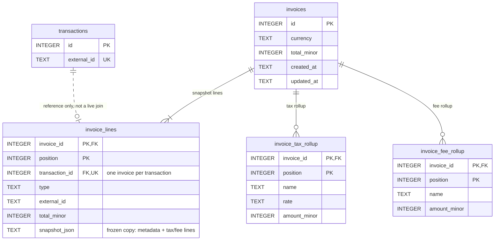

# Architecture

## Seams

```
HTTP          transaction.controller / invoice.controller   parse, validate shape, map to and from JSON
Use cases     transaction.service / invoice.service         @Transactional boundary, business rules
Identity      transaction.identity                          one row per external_id (DB-enforced)
Persistence   transaction.persistence (+ metadata/*)        SQL for header, tax/fee lines, per-type tables
              invoice.persistence                           SQL for invoice header, snapshot lines, rollups
Snapshot      invoice.snapshot                              pure: transactions → invoice draft + rollups
Models        transaction.dto / invoice.dto                 records shared by the layers above
Shared        common.*                                      errors, public ids, money, paging, time
```

Every use case is one DB transaction. Services own `@Transactional`, and repositories are `MANDATORY`, so they
cannot run outside one.

Dependencies point invoice → transaction. Transaction asks "is this invoiced?" through `InvoiceReferenceChecker`, an
interface it owns and `InvoiceRepository` implements.

## `external_id` uniqueness & concurrent POSTs

The unique index `ux_transactions_external_id` decides, not application code. `TransactionIdentityService.claim`
inserts the header with `ON CONFLICT (external_id) DO NOTHING RETURNING id`.

- A returned id means this request won.
- No row means the `external_id` already exists. The request gets `409 duplicate_external_id`, with the stored row's
  `existing_id`.

Lines and metadata are written in the same DB transaction, so if any of them fails the header rolls back too.

**Concurrent POSTs.** Nothing reads first and inserts later, so two overlapping POSTs cannot both win.

- Under `transaction_mode=IMMEDIATE`, the second POST waits for the first to commit, then conflicts.
- Without it (on Postgres, for example), `ON CONFLICT` still lets only one through.

`ConcurrentDuplicateCreateTest` (16 overlapping POSTs) and `TransactionIdentityServiceTest` cover this.

**Decisions:**

- A duplicate is `409`, not `200`.
- Bodies are not compared, and the stored row is never overwritten.
- The duplicate check runs before body rules, so the fixture's `duplicate_flight` (empty `coupons`) gets `409`, not
  `400`.

## Invoice snapshot

An invoice is built from **stored** transactions and copied when it is written. It is never read back through
`transactions`.

- **Write.** `InvoiceSnapshotBuilder` is a pure function. It checks the currency and copies each transaction into a
  `TransactionSnapshot`, stored as `snapshot_json`. It also sums the total exactly and builds the rollups, which are
  stored too.
  - Taxes group by `(name, rate)`, with rates compared as numbers.
  - Fees group by `name`.
  - Both keep first-seen order.
- **Read.** Reads use only the four invoice tables, with no join to `transactions`. `t04_invoiceIsASnapshot` changes
  the flight in SQL, and the invoice still shows `220.00`.
- **Rules.** All are checked before the first write.
  - Same id twice → `409`.
  - Unknown id → `404`.
  - Already on another invoice → `409 transaction_already_invoiced`.
  - Mixed currency → `409`.
  - A transaction on an invoice is frozen: PATCH and DELETE on it → `409`.

  The schema backs the invoiced-transaction rules too (see README §4). If its unique index ever fired, the request
  would be a `500` and roll back, because Spring does not classify SQLite constraint errors. Under `IMMEDIATE` the
  service check always runs first, so this does not happen.
- **PATCH** rebuilds from the current stored transactions in one DB transaction. A failure leaves the invoice
  unchanged.
- **DELETE** cascades to the lines and rollups. The transactions are kept and become editable again.

The snapshot is JSON because it is written once and read whole, and nothing queries inside it. It also has to keep
its shape if the transaction model changes. The fields that are queried (`transaction_id`, `type`, `external_id`,
`total_minor`) are real columns, and the rollups have their own tables.

## Tables & models

### Transactions


- **Taxes vs fees** are separate tables and separate types: `TaxLine(name, rate?, amount)` and `FeeLine(name,
  amount)`. A tax may have a rate and a fee never does, and they roll up differently. `position` keeps list order.
- **Type-specific data** lives in per-type tables (the edges labelled `type=…`). The header holds only what every
  type shares. Tables were chosen over a JSON column for three reasons:
  - the schema enforces required fields (`NOT NULL`, the `fee_kind` CHECK);
  - fields can be indexed (flight number, related booking);
  - money is in minor units everywhere.

  The cost is that a new type needs a migration and a `MetadataStore`.
- **In Java**, `TransactionMetadata` is a sealed interface with one record per type. Jackson picks the subtype from
  the sibling `type` field. `MetadataStoreRegistry` routes each type to its store, and fails at startup if a type
  has none.

### Invoices



## Money

Amounts are `BigDecimal` in Java and `INTEGER` minor units at scale 2 in the database. An amount with more than 2
decimals is a `400`; it is never rounded. Sums are exact, and rates are stored as decimal TEXT.

Known limits:

- The scale is fixed at 2, so JPY or KWD would need a per-currency scale.
- `total` is not reconciled against its parts.
- Negative amounts are accepted.

## High volume

Indexes, pagination and constraints are listed in [README → Database & volume](README.md#4-database--volume).
Under concurrent PATCH, duplicate POST and large lists, problems arrive in this order:

1. **SQLite's single writer.**
   - `IMMEDIATE` makes every transaction, reads included, take the write lock at `BEGIN`, so requests queue.
   - A request that waits longer than `busy_timeout` (5 s) fails as a `500`.
   - Correctness holds while requests queue: no torn tax/fee lists, no duplicate rows, and no PATCH between the
     invoiced check and the write. `ConcurrentPatchDeleteTest` covers 12 overlapping PATCHes × 5 rounds, and PATCHes
     racing a DELETE. The cost is latency.
   - `jdbc.explicit_readonly` was tried to let reads skip the lock. GETs still waited and invoice requests failed,
     so it was dropped.
2. **N+1 hydration on lists.** Pages are bounded (keyset, at most 100 rows). Each row still costs 3–4 indexed
   lookups, or 3 per invoice, and invoice pages carry every line's snapshot JSON.
3. **Duplicate POSTs are cheap.** Each one is a single unique-index probe, and the conflict is a no-op insert, not an
   exception.
